<div align="center">

# KoboDash

**Turn a 2011 Kobo Touch A into an instant offline e-reader, dictionary, and multi-week-battery TLS 1.3 e-ink desk dashboard.**

-1f2937?style=flat-square)


-7c3aed?style=flat-square)


[BLUF](#-bluf--bottom-line-up-front) · [Screenshots](#-visual-tour) · [Quick Start](#-quick-start) · [Architecture](#-architecture--lifecycles) · [Implementation Methods](#-implementation--integration-methods) · [Agent & Contributor Spec](#-agent--contributor-reference)

<br>

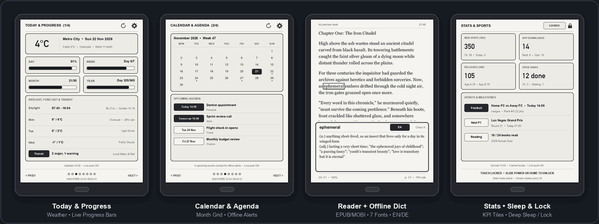

</div>

---

## 🎯 BLUF — Bottom Line Up Front

> [!IMPORTANT]
> - **What it is:** A single **481 KB** native C11 binary (`~2 MB` RAM) for the **Kobo Touch A (N905, 256 MB RAM, Linux 2.6.35.3)** that combines an instant `.epub`/`.mobi`/`.txt` reader + offline EN/DE dictionaries with a self-hosted HTTPS/SSE e-ink desk dashboard and true `suspend-to-RAM` deep sleep.
> - **Why it exists:** Stock Nickel is slow for quick reading and cannot stay asleep as a live desk display; browser-based dashboards melt a 256 MB ARMv7 CPU and die on modern TLS 1.3. KoboDash renders straight to `/dev/fb0` via FBInk with waveform-aware partial refreshes and statically linked mbedTLS 3.6.
> - **Zero brick risk:** Never modifies the bootloader, kernel, partitions, or `/etc/init.d/rcS`. Hold **Home (2s)** from anywhere to jump back to Stock Kobo UI (Nickel). Optional auto-boot is gated by `--self-test` and a 15-second crash circuit-breaker.
> - **Zero lock-in:** Works **100% offline**, against any **600×800 PNG/JPG endpoint**, with the included **zero-dependency Python 3 server**, or with **your own backend** in any language.

| Spec | Value |
| --- | --- |
| **Verified Hardware** | Original Kobo Touch A (`N905` / `PLATFORM=freescale` / i.MX508 Cortex-A8 800 MHz / 256 MB RAM / 600×800 16-level E-Ink) |
| **Runtime Footprint** | `481 KB` stripped ARM ELF (`glibc 2.19`) · `~2 MB` RSS · zero Python/Node/Qt/browser runtime on device |
| **E-Ink Rendering** | Direct `/dev/fb0` via `libfbink`: `WFM_DU` zero-flash clock/toggles + `WFM_GC16` crisp partial grayscale book pages |
| **Networking & Security** | Native TLS 1.2 / 1.3 (static mbedTLS 3.6.3 + CA bundle), Bearer auth, `ETag`/`304`, SNTP, `<1s` SSE push |
| **Power & Standby** | Hardware `mem` suspend + `ar6000` radio power-off + `rtc0/wakealarm` rotating sleep art (multi-week standby) |
| **Reversibility** | Hold **Home (2s)** → Stock Nickel UI; delete `.adds/kobodash/` over USB for clean uninstall |

---

## 🖼️ Visual Tour

All images below are pixel-exact renders generated directly from the compiled C firmware (`make -C firmware preview`).

### Multi-Page Self-Hosted Dashboard

<table>
  <tr>
    <td align="center" width="25%">
      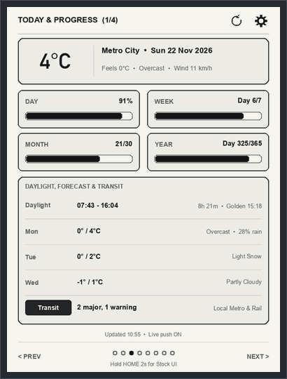<br>
      <sub><b>1. Today &amp; Progress</b><br>Weather, local live Day/Week/Month/Year bars, daylight &amp; forecast</sub>
    </td>
    <td align="center" width="25%">
      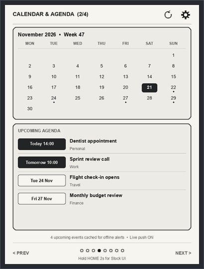<br>
      <sub><b>2. Calendar &amp; Agenda</b><br>Month grid with event dots + locally cached offline reminders</sub>
    </td>
    <td align="center" width="25%">
      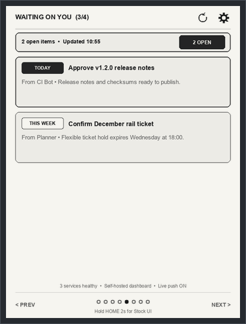<br>
      <sub><b>3. Waiting on You</b><br>Prioritized action &amp; approval cards synced over live SSE</sub>
    </td>
    <td align="center" width="25%">
      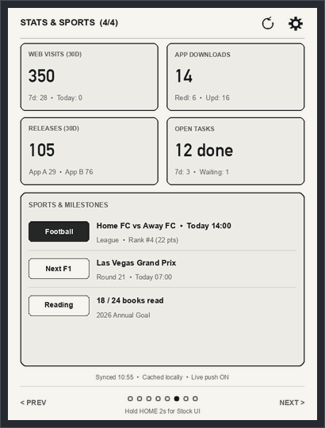<br>
      <sub><b>4. Stats &amp; Milestones</b><br>2×2 KPI metric tiles + sports, reading goals &amp; milestones</sub>
    </td>
  </tr>
</table>

### Reading, Real-Time Alerts, Deep Sleep & Touch-Lock

<table>
  <tr>
    <td align="center" width="25%">
      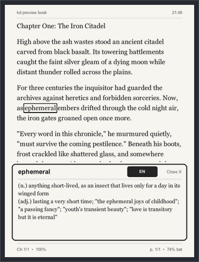<br>
      <sub><b>Instant Reader + Dict</b><br>Long-press any word for offline WordNet EN / EN↔DE lookup</sub>
    </td>
    <td align="center" width="25%">
      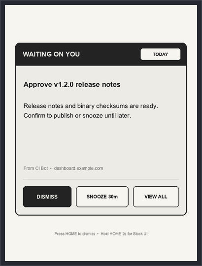<br>
      <sub><b>Dual Trigger Overlay</b><br>Offline calendar alerts &amp; &lt;1s remote SSE push (Dismiss / Snooze 30m)</sub>
    </td>
    <td align="center" width="25%">
      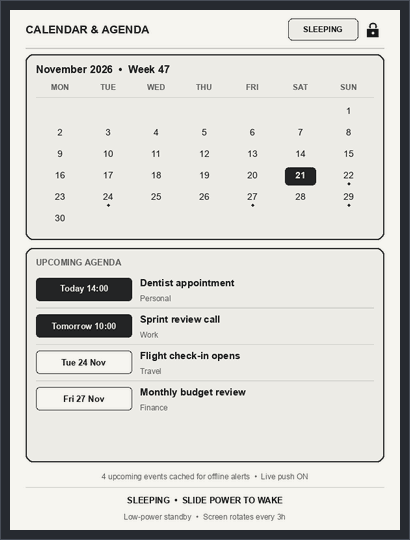<br>
      <sub><b>True Deep Sleep</b><br>Wi-Fi off, CPU in <code>mem</code> suspend, RTC wakes to rotate art every 1–6h</sub>
    </td>
    <td align="center" width="25%">
      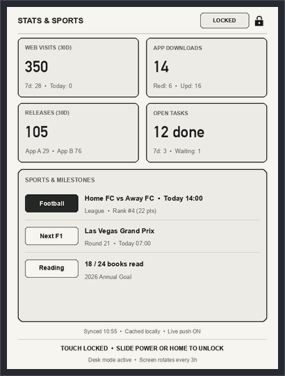<br>
      <sub><b>Touch-Lock Desk Mode</b><br>Plugged-in lock ignores touches while keeping live SSE &amp; rotation</sub>
    </td>
  </tr>
</table>

<details>
<summary><b>More screenshots</b> — Minimal Clock (Light &amp; Dark), Reader Toolbar, 4-Tab Settings &amp; E-Ink QWERTY Keyboard</summary>
<br>
<table>
  <tr>
    <td align="center" width="33%">
      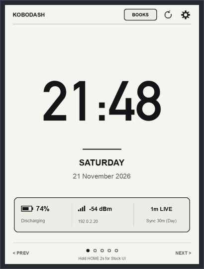<br>
      <sub><b>Minimal Clock (Light)</b> — Zero-flash minute DU refresh + live status strip</sub>
    </td>
    <td align="center" width="33%">
      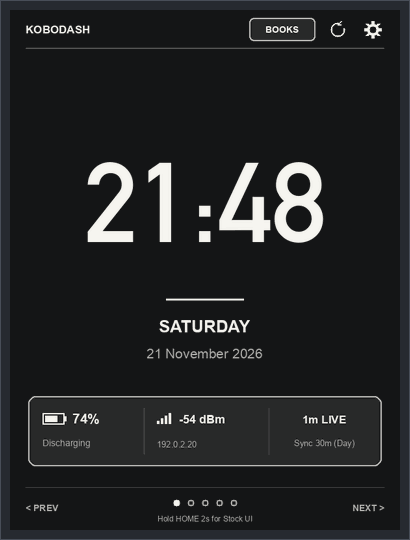<br>
      <sub><b>Minimal Clock (Dark)</b> — Full inverted e-ink night mode</sub>
    </td>
    <td align="center" width="33%">
      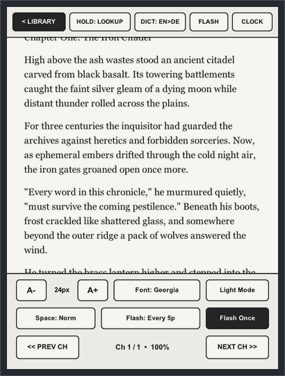<br>
      <sub><b>Reader Toolbar</b> — 7 font families, spacing, flash cadence, EN/DE toggle</sub>
    </td>
  </tr>
  <tr>
    <td align="center" width="33%">
      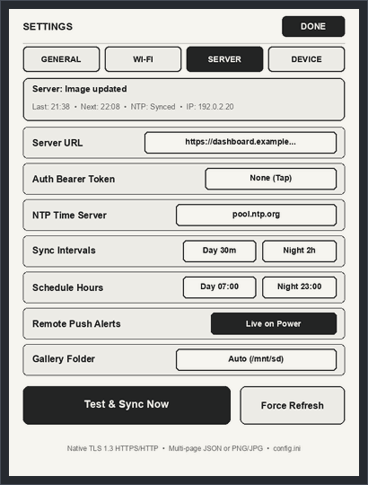<br>
      <sub><b>Settings → Server</b> — HTTPS URL, Bearer token, Day/Night sync &amp; SSE push</sub>
    </td>
    <td align="center" width="33%">
      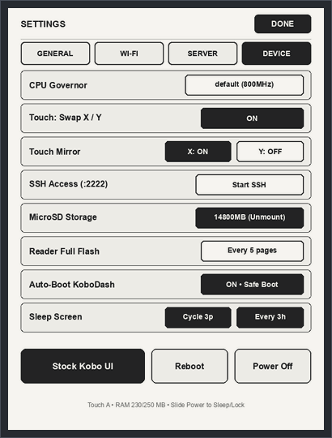<br>
      <sub><b>Settings → Device</b> — Auto-boot, sleep rotation, SSH, MicroSD, touch calibration</sub>
    </td>
    <td align="center" width="33%">
      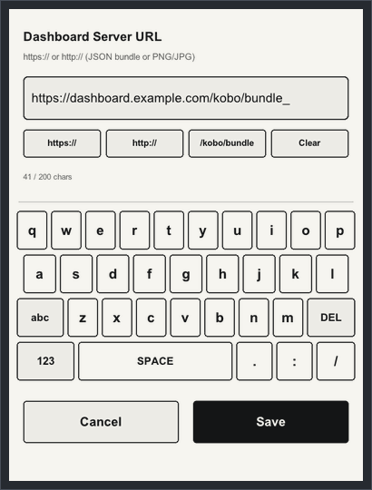<br>
      <sub><b>Touch QWERTY Keyboard</b> — Edit Wi-Fi passwords, URLs &amp; tokens on-device</sub>
    </td>
  </tr>
</table>
</details>

---

## ✨ What's Inside

| Pillar | Capabilities |
| --- | --- |
| **📖 Offline Reader & Dictionaries** | Native `.epub`, `.mobi`, and `.txt` parser with UTF-8/CP1252/UTF-16 decoding, HTML entity & mojibake repair, MOBI record-boundary stitching, **7 on-demand font families** (Georgia, Charter, Palatino, Baskerville, Times New Roman, Verdana, Trebuchet MS), and instant long-press lookup against binary `.kdict` dictionaries (English WordNet + English↔German FreeDict with stemming). |
| **📊 TLS 1.3 Dashboard & Dual Triggers** | Client-only **mbedTLS 3.6.3** statically linked with `cacert.pem` verification, `Authorization: Bearer`, and `ETag`/`304`. Renders 4 native e-ink page layouts (plus legacy 600×800 images). **Offline Calendar Triggers** fire from cached `bundle.json` even without Wi-Fi; **Live SSE Push** (`Live on Power` / `Always Live` / `Poll Only`) pops alerts in `<1s` and auto-clears overlays when resolved remotely — while never interrupting active reading. |
| **🔋 True Deep Sleep & Touch-Lock** | **Unplugged + Slide Power** (or configurable **Auto-Sleep** `5m–60m`) powers down `ar6000`, draws locked rotating sleep art (`Today → Calendar → Stats` every `1–6h`), arms `/sys/class/rtc/rtc0/wakealarm`, and suspends to `/sys/power/state` (`mem`). **Plugged In + Slide Power** enters **Touch-Lock Desk Mode** (ignores accidental taps while staying live). |
| **📶 Touch A Wi-Fi & 4-Tab Settings** | Scan networks, connect WPA/WPA2 & hidden SSIDs, forget networks, and run a 1-tap `ar6000` + `sdio_wifi_pwr` hardware reset for stubborn routers and mobile hotspots. Configure everything on-device (`GENERAL`, `WI-FI`, `SERVER`, `DEVICE`). |
| **🛡️ Brick-Proof Auto-Boot** | Optional 2-file udev hook (`KERNEL=="loop0"`) gated by `kobodash --self-test`, a once-per-boot RAM lock (`/tmp/kobodash-autoboot.done`), and an automatic 15-second crash/bootloop circuit-breaker. |

### Hardware & Touch Controls

| Gesture / Button | Action |
| --- | --- |
| **Swipe Left / Right** or **`< PREV` / `NEXT >`** | Cycle screens (`Clock → Library → Dashboard Pages → System Status → Gallery`) |
| **Tap Gear** (or **Swipe Up**) | Open 4-tab Settings (`GENERAL`, `WI-FI`, `SERVER`, `DEVICE`) |
| **Tap Refresh** (or **Swipe Down**) | Sync dashboard & SNTP clock immediately |
| **Long-press word** *(in Reader)* | Offline dictionary popup (tap language pill for `EN` / `EN→DE` / `DE→EN`) |
| **Short-press Home** | Next screen / unlock Touch-Lock / dismiss alert overlay |
| **Hold Home (2s)** | Cleanly exit KoboDash and return to **Stock Kobo UI (Nickel)** |
| **Slide Power** | **Deep Sleep** (unplugged) or **Touch-Lock** (plugged in); slide again to wake/unlock |
| **Hold Power (2.4s)** | Clean Power Off from anywhere |

---

## 🚀 Quick Start

### Prerequisites
- **Build machine (macOS or Linux):** [Zig](https://ziglang.org/) (`0.14+`, tested on `0.16.0`), system `cc`, Python `3.11+` (`pip install -r requirements.txt`).
- **On Kobo Touch A:** [NickelMenu](https://pgaskin.net/NickelMenu/) installed, plus `libfbink.so.1` and `libz.so.1` placed in `artifacts/inspect/` (from [NiLuJe's FBInk](https://github.com/NiLuJe/FBInk) / KoboStuff).
- **Backup first:** Connect your Kobo over USB and run `python3 scripts/backup.py`.

### 1. Build ARM Firmware, Run All Tests & Render Previews

```sh
# Automatically downloads mbedTLS 3.6.3 on first build, compiles the 481 KB ARMv7 binary,
# runs all 245 host C checks, and renders 600x800 PNG previews to output/firmware-preview/
make -C firmware all preview
```

### 2. Compile Offline Dictionaries *(Optional)*

```sh
python3 scripts/build_dict.py
# Produces output/en.kdict, output/en-de.kdict, output/de-en.kdict
```

### 3. Deploy to USB-Mounted Kobo

Connect Kobo in Stock UI (`Connect`), then run:

```sh
# Standard deploy: updates .adds/kobodash/ & NickelMenu entry (preserves existing config.ini)
python3 scripts/deploy_firmware.py

# Optional: configure your self-hosted dashboard URL & Bearer token on first deploy
python3 scripts/deploy_firmware.py \
  --server-url "https://dashboard.example.com/kobo/bundle" \
  --server-token "your-strong-random-token"

# Optional: also stage the 2-file brick-proof udev auto-boot package (.kobo/KoboRoot.tgz)
python3 scripts/deploy_firmware.py --install-autoboot
```

Safely eject USB, then open **NickelMenu → KoboDash** (or reboot if `--install-autoboot` was enabled).

---

## 🧭 Architecture & Lifecycles

### 1. System & Data Flow Architecture

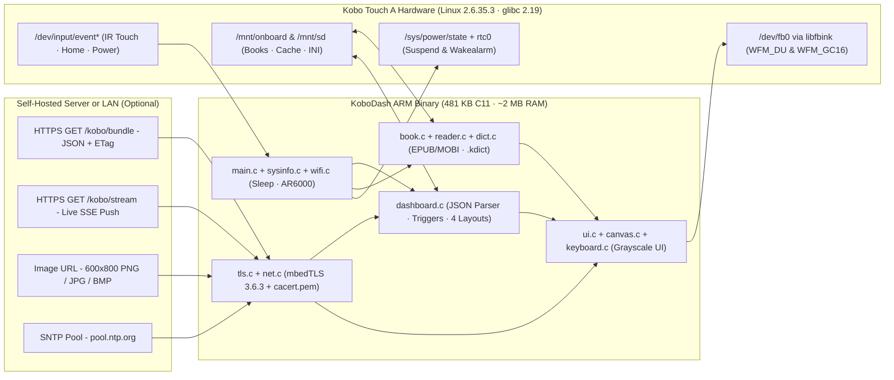

### 2. Power, Deep Sleep & Touch-Lock State Machine

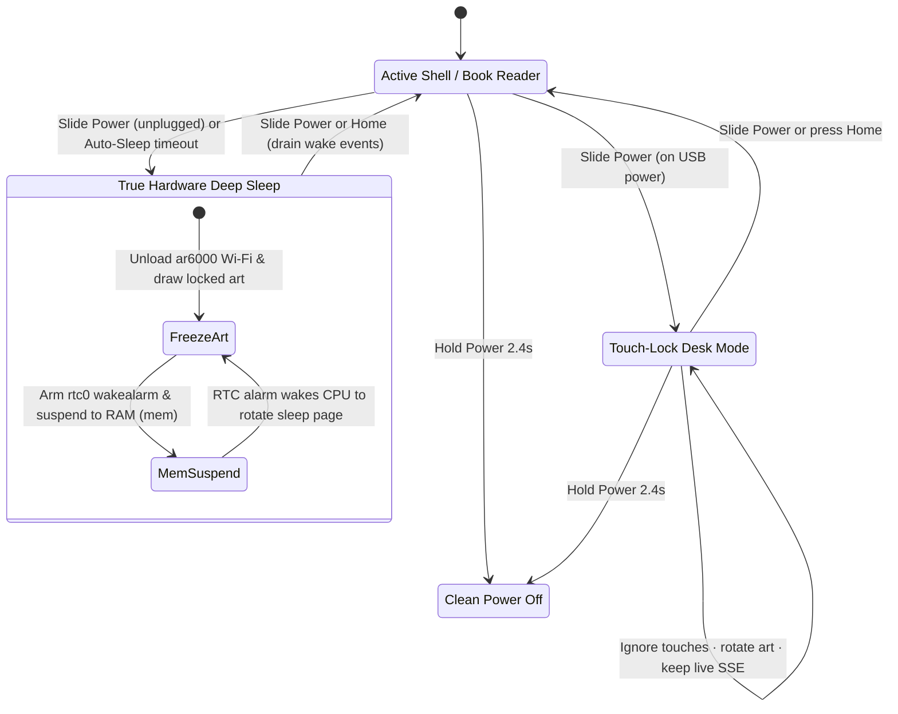

### 3. Brick-Proof Auto-Boot & Failsafe Pipeline

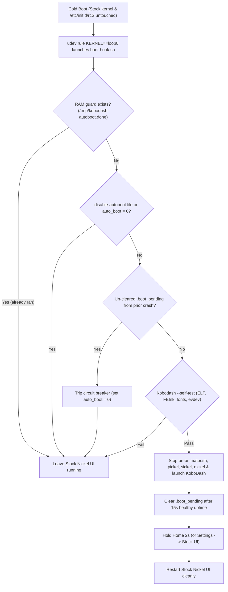

---

## 🔌 Implementation & Integration Methods

Choose whichever backend complexity matches your setup — **no firmware recompilation is required** to switch methods (just change `server_url` in Settings or `config.ini`):

| Method | Best For | Requirements | Supports Offline Calendar Alerts & Live SSE? |
| --- | --- | --- | --- |
| **A. Built-in Reference Server** | Fast self-hosted setup in 2 minutes | Python 3.11+ (zero pip packages) + HTTPS reverse proxy | ✅ Yes (Full Bundle + SSE) |
| **B. Custom Backend / Proxy Adapter** | Integrating existing dashboards (Glance, Home Assistant, Go/Node/Rust) | Any HTTP/HTTPS server returning JSON | ✅ Yes (Full Bundle + SSE) |
| **C. Static 600×800 Image / TRMNL** | Existing image generators (TRMNL, Playwright, Pillow, Grafana) | Any URL returning PNG/JPG/BMP/GIF or 3-field legacy JSON | ❌ Image display only |
| **D. 100% Offline Standalone** | Pure distraction-free reader, dictionary, clock & photo frame | None (`server_url` empty) | ✅ Offline clock/reader/gallery |

### Method A — Zero-Dependency Python Reference Server

Run [`server/kobodash_server.py`](server/kobodash_server.py) behind Caddy, Nginx, or Cloudflare Tunnel:

```sh
KOBODASH_TOKEN="choose-a-strong-random-token" \
KOBODASH_CITY="London" KOBODASH_LAT="51.5074" KOBODASH_LON="-0.1278" KOBODASH_TZ="Europe/London" \
KOBODASH_DATA_DIR="./kobodash-data" \
python3 server/kobodash_server.py
```

Drop optional `events.json`, `alerts.json`, and `stats.json` files into `KOBODASH_DATA_DIR` (re-read live on every request and watched by `/kobo/stream` for instant SSE pushes), then set `server_url = https://<your-host>/kobo/bundle`.

### Method B — Custom Backend (Wire Contract)

Point `server_url` to any URL ending in `/bundle`. KoboDash automatically derives `/stream` in the same path prefix when `push_mode > 0`, sends `Authorization: Bearer <token>`, `If-None-Match: <etag>`, `X-Kobo-Battery: <pct>`, and `X-Kobo-RSSI: <dbm>`, and caches the response on disk for offline reminders.

<details>
<summary><b>Click to expand full JSON Bundle &amp; SSE Push Schema</b></summary>

#### 1. `GET /.../bundle` (`application/json`, supports `ETag` / `304 Not Modified`)

```json
{
  "version": 1,
  "generated_ts": 1795254900,
  "updated": "10:55",
  "pages": [
    {
      "id": "today",
      "kind": "overview",
      "title": "TODAY & PROGRESS",
      "subtitle": "London  •  Sun 22 Nov 2026",
      "hero": "4°C",
      "hero_sub": "Feels 0°C  •  Overcast  •  Wind 11 km/h",
      "bars": [
        { "label": "DAY", "pct": 45, "detail": "45%" },
        { "label": "WEEK", "pct": 92, "detail": "Day 7/7" },
        { "label": "MONTH", "pct": 73, "detail": "22/30" },
        { "label": "YEAR", "pct": 89, "detail": "Day 326/365" }
      ],
      "items": [
        { "label": "Daylight", "value": "07:43 - 16:04", "detail": "8h 21m", "urgent": false }
      ],
      "footer": "Updated 10:55"
    },
    {
      "id": "calendar",
      "kind": "calendar",
      "title": "CALENDAR & AGENDA",
      "subtitle": "November 2026  •  Week 47",
      "cal_year": 2026,
      "cal_month": 11,
      "cal_today": 22,
      "cal_marks": [22, 24, 27, 29],
      "items": [
        { "label": "Today 14:00", "value": "Dentist appointment", "detail": "Personal", "urgent": true }
      ],
      "footer": "4 upcoming events cached"
    },
    {
      "id": "waiting",
      "kind": "list",
      "title": "WAITING ON YOU",
      "subtitle": "1 open item",
      "badge": "1 OPEN",
      "items": [
        { "label": "TODAY", "value": "Approve v1.2.0 release notes", "detail": "From CI Bot", "urgent": true }
      ],
      "footer": "Live push ON"
    },
    {
      "id": "stats",
      "kind": "stats",
      "title": "STATS & MILESTONES",
      "subtitle": "Updated 10:55",
      "metrics": [
        { "label": "WEB VISITS (30D)", "value": "350", "detail": "7d: 28  •  Today: 0" },
        { "label": "UPTIME", "value": "99.9%", "detail": "All services healthy" }
      ],
      "items": [
        { "label": "Reading", "value": "18 / 24 books read", "detail": "2026 Goal", "urgent": false }
      ],
      "footer": "Synced 10:55"
    }
  ],
  "events": [
    {
      "id": "ev_dentist",
      "start_ts": 1795266000,
      "all_day": false,
      "remind_min": 15,
      "title": "Dentist appointment",
      "tag": "Personal",
      "when_label": "Today 14:00",
      "soon": true
    }
  ],
  "alerts": [
    {
      "id": "ci_rel_120",
      "title": "Approve v1.2.0 release notes",
      "body": "Release notes and binary checksums are ready.",
      "source": "CI Bot",
      "due": "TODAY",
      "urgent": true,
      "ts": 1795254600
    }
  ]
}
```

#### 2. `GET /.../stream` (`text/event-stream`)

Emit a single-line JSON event on connect and whenever open `alerts` change (plus `: keepalive` comments every ~30s):

```text
event: alerts
data: {"version":1,"updated":"10:56","hash":"a1b2c3d4","alerts":[...]}
```

Sending `"alerts": []` automatically dismisses any active remote alert overlay on the Kobo.

#### 3. Legacy Simple JSON Fallback

If a server returns `{"title":"...","subtitle":"...","lines":["..."]}` (without `pages[]`), KoboDash renders it cleanly as a single native text dashboard page.

</details>

### Method C — Static 600×800 Image / TRMNL Server

Point `server_url` to any HTTPS/HTTP endpoint returning a `600×800` PNG, JPEG, BMP, or GIF (`Content-Type: image/*`). KoboDash decodes, scales/centers, and caches it automatically. Optional legacy TRMNL/Terminus helper scripts are also kept in [`scripts/prepare_trmnl.py`](scripts/prepare_trmnl.py), [`scripts/configure_trmnl.py`](scripts/configure_trmnl.py), and [`server/compose.yml`](server/compose.yml).

### Method D — 100% Offline Mode

Leave `server_url` empty. KoboDash operates with Wi-Fi disabled as a fast `.epub`/`.mobi`/`.txt` reader, offline EN/DE dictionary, minimal e-ink clock, and MicroSD screensaver gallery.

---

## 🤖 Agent & Contributor Reference

> This section is structured for **AI coding agents and firmware contributors** so you can modify, test, and deploy safely without rediscovering Kobo Touch A hardware quirks. Read [`docs/discovery.md`](docs/discovery.md) and [`docs/recovery.md`](docs/recovery.md) before changing boot, sleep, or linker code.

### Hard Hardware & Toolchain Invariants (Do Not Break)

1. **Zig + glibc 2.19 `RELRO` SIGSEGV (`Zig #18773`):** ARM links **must** keep `-Wl,-z,norelro -Wl,-z,lazy` in `firmware/Makefile` with `zig cc --target=arm-linux-gnueabihf.2.19 -mcpu=cortex_a8`. Verify zero `PT_GNU_RELRO` segment before deploying.
2. **Never patch `/etc/init.d/rcS` or open `/dev/ntx_io`:** Auto-boot uses only the 2-file udev rule (`KERNEL=="loop0"`). On Touch A (`PLATFORM=freescale`), `/dev/ntx_io` is a 0-byte regular file — never call `ntx_io` ioctls.
3. **Always stop `on-animator.sh` & `pickel` before drawing:** Stopping Nickel early leaves `/etc/init.d/on-animator.sh` painting the 3-dot boot animation over `/dev/fb0`. `firmware/device/runner.sh` kills `on-animator.sh` and `pickel` before drawing splash or launching KoboDash.
4. **BusyBox 1.17 `ash` quoting:** Stock Kobo `ash` aborts (exit 2) on nested double quotes inside `"$(cmd "$var")"`. Always write `var=$(cmd "$arg")` without outer quotes on variable assignments.
5. **E-Ink waveform discipline:** Use `WFM_DU` (`KD_REFRESH_FAST_MONO`) only for minute clock digits and crisp 1-bit toggles; use non-flashing `WFM_GC16` (`KD_REFRESH_GRAY_PARTIAL`) for anti-aliased book pages; avoid `WFM_GL16` and `WFM_A2` on Touch A.
6. **`ar6000` Wi-Fi radio reset:** Never rely on `ifconfig wlan0 down/up` alone after hotspot reconnects or sleep; `firmware/device/wifi-ctl.sh` must unload/reload both `ar6000.ko` and `sdio_wifi_pwr.ko`, flush `dhcpcd` state, disable power management, and set `scan_ssid=1`.
7. **TLS 1.3 on Linux `2.6.35.3`:** Kernel predates `getrandom(2)` (`ENOSYS` → mbedTLS falls back to `/dev/urandom`). Cold boots may reset RTC to `1970`; `tls.c` skips **only** certificate time-window checks when `time(NULL) < 2024` (still verifying signature chain & hostname) so initial HTTPS `Date` / NTP can bootstrap the clock.
8. **Safe `suspend-to-RAM` ordering (`sysinfo.c`):** `display_wait_complete()` → `wifi-ctl.sh off` → clear then arm `/sys/class/rtc/rtc0/wakealarm` → `sync()` → write `1` to `/sys/power/state-extended` → sleep 200 ms → write `mem` to `/sys/power/state` → on resume write `0` to `state-extended`, clear `wakealarm`, and drain wake evdev events.
9. **macOS AppleDouble hygiene:** `scripts/deploy_firmware.py` scrubs `._*` files and stages clean tarballs so Nickel never indexes macOS metadata files as books.

### Module Ownership Map

| Path | Responsibility |
| --- | --- |
| [`firmware/Makefile`](firmware/Makefile) | Cross-compile ARM binary (Zig `arm-linux-gnueabihf.2.19`), host C unit test binary, and preview generator |
| [`firmware/include/kobodash.h`](firmware/include/kobodash.h) | Shared structs (`Config`, `DashboardBundle`, `Book`, `ReaderState`, `InputEvent`), screen/refresh enums & APIs |
| [`firmware/include/kd_mbedtls_config.h`](firmware/include/kd_mbedtls_config.h) | Stripped client-only TLS 1.2 + TLS 1.3 mbedTLS 3.6 configuration |
| [`firmware/src/main.c`](firmware/src/main.c) | Main event loop, async sync worker, SSE watcher thread, auto-sleep timer, deep sleep & touch-lock |
| [`firmware/src/dashboard.c`](firmware/src/dashboard.c) | Recursive-descent JSON bundle/alert parser, disk cache, offline/remote trigger engine, 4-page & sleep-art renderers |
| [`firmware/src/tls.c`](firmware/src/tls.c) / [`net.c`](firmware/src/net.c) | mbedTLS 3.6 socket wrapper (`cacert.pem`), HTTP/1.1 client, `ETag`/`304`, SNTP, SSE stream parser |
| [`firmware/src/ui.c`](firmware/src/ui.c) / [`canvas.c`](firmware/src/canvas.c) | Screen layouts, 4-tab Settings UI, 16-level grayscale drawing primitives & vector icons (padlock, Wi-Fi, battery) |
| [`firmware/src/book.c`](firmware/src/book.c) / [`reader.c`](firmware/src/reader.c) | `.epub`/`.mobi`/`.txt` decoding, pagination, progress persistence, typography & dictionary overlay |
| [`firmware/src/dict.c`](firmware/src/dict.c) / [`font.c`](firmware/src/font.c) | Binary `.kdict` indexed search with stemming/lemmatization & `stb_truetype` on-demand multi-family font loader |
| [`firmware/src/input.c`](firmware/src/input.c) / [`keyboard.c`](firmware/src/keyboard.c) | `evdev` IR touch transform + Home/Power short/long detection (`INPUT_POWER_LONG` 2.4s) & QWERTY touch keyboard |
| [`firmware/src/sysinfo.c`](firmware/src/sysinfo.c) / [`wifi.c`](firmware/src/wifi.c) | Battery/RAM/Wi-Fi telemetry, safe `mem` deep sleep + `rtc0/wakealarm`, `wifi-ctl.sh` wrapper |
| [`firmware/device/`](firmware/device/) | BusyBox `ash` wrappers (`runner.sh`, `autoboot.sh`, `boot-hook.sh`, `wifi-ctl.sh`, `99-kobodash.rules`, `cacert.pem`) |
| [`firmware/tests/test_kobodash.c`](firmware/tests/test_kobodash.c) | 245 host C unit checks + `--dump-dir` framebuffer dumper (zero Kobo hardware needed to test UI & logic) |
| [`server/kobodash_server.py`](server/kobodash_server.py) | Standalone zero-dependency Python 3 reference server (Open-Meteo + local JSON + SSE) |
| [`scripts/`](scripts/) | `fetch_mbedtls.py`, `build_mbedtls.py`, `build_dict.py`, `deploy_firmware.py`, `preview_firmware.py`, `build_readme_assets.py` |

### Agent Verification Loop

Run this single chain after any firmware, server, or UI change:

```sh
# 1. Cross-compile ARM binary + run all 245 host C checks + dump 600x800 PNG previews
make -C firmware all preview

# 2. Run all 14 Python unit tests & syntax-check server/scripts
python3 -m unittest discover -s tests -v && python3 -m py_compile server/kobodash_server.py scripts/*.py

# 3. Verify Zig/LLD did not emit PT_GNU_RELRO on the ARM ELF (must print: GNU_RELRO=False)
python3 -c '
import struct
b = open("firmware/build/kobodash", "rb").read()
e_phoff, e_phentsize, e_phnum = struct.unpack_from("<I", b, 28)[0], struct.unpack_from("<H", b, 42)[0], struct.unpack_from("<H", b, 44)[0]
relro = any(struct.unpack_from("<I", b, e_phoff + i * e_phentsize)[0] == 0x6474e552 for i in range(e_phnum))
print(f"ARM size={len(b)} bytes, GNU_RELRO={relro}")
assert not relro
'

# 4. (Optional, if UI changed) Refresh framed README showcase assets in docs/images/
python3 scripts/build_readme_assets.py
```

<details>
<summary><b>Full <code>config.ini</code> Reference</b> (stored at <code>/mnt/onboard/.adds/kobodash/config.ini</code>)</summary>

| Section | Key | Default | Valid Values / Notes |
| --- | --- | --- | --- |
| `[display]` | `minute_clock` | `1` | `0` or `1` — fast `WFM_DU` minute tick on Clock screen |
| `[display]` | `invert_mode` | `0` | `0` (Light) or `1` (Dark inverted) |
| `[display]` | `clock_24h` | `1` | `1` (24-hour) or `0` (12-hour) |
| `[display]` | `full_refresh_every` | `15` | `1–120` — anti-ghosting full flash cadence |
| `[display]` | `gallery_clock_overlay` | `1` | `0` or `1` — show time badge over gallery photos |
| `[display]` | `start_screen` | `clock` | `clock`, `library`, `dashboard`, `status`, `gallery` |
| `[reader]` | `reader_font_px` | `24` | `16–36` px body font size |
| `[reader]` | `reader_line_spacing` | `1` | `0` (Compact), `1` (Normal), `2` (Wide) |
| `[reader]` | `reader_flash_every` | `5` | `1–50` pages between full anti-ghosting flashes |
| `[reader]` | `reader_font_family` | `georgia` | `georgia`, `charter`, `palatino`, `baskerville`, `times`, `verdana`, `trebuchet` |
| `[reader]` | `dict_lang` | `en` | `en`, `en-de`, `de-en` |
| `[schedule]` | `day_interval_min` | `30` | `1–1440` min server sync interval during daytime |
| `[schedule]` | `night_interval_min` | `120` | `0–1440` min server sync interval at night (`0` = paused) |
| `[schedule]` | `day_start_hour` / `night_start_hour` | `7` / `23` | `0–23` local hour boundaries |
| `[schedule]` | `auto_rotate_min` | `0` | `0–720` min active screen rotation (`0` = off) |
| `[schedule]` | `auto_sleep_min` | `15` | `0–240` min inactivity before deep sleep / touch-lock (`0` = off) |
| `[schedule]` | `sleep_style` | `0` | `0` (`Cycle 3p`), `1` (`Today`), `2` (`Calendar`), `3` (`Stats`), `4` (`Clock`) |
| `[schedule]` | `sleep_rotate_hrs` | `3` | `0–24` hours between RTC wakeups to rotate sleep art (`0` = static) |
| `[time]` | `tz_posix` | `CET-1CEST,M3.5.0,M10.5.0/3` | Standard POSIX TZ string |
| `[time]` | `ntp_server` | `pool.ntp.org` | Hostname or IPv4 for SNTP sync |
| `[server]` | `server_url` | *(empty)* | `https://...` or `http://...` (JSON `/bundle`, legacy JSON, or 600×800 image) |
| `[server]` | `server_token` | *(empty)* | Sent as `Authorization: Bearer <token>` |
| `[server]` | `push_mode` | `1` | `0` (Poll Only), `1` (Live SSE on USB Power), `2` (Always Live SSE) |
| `[gallery]` | `screensaver_dir` | *(auto)* | Custom folder; auto-scans `/mnt/sd/screensavers`, `/mnt/sd/images`, `.adds/kobodash/screensavers` |
| `[touch]` | `touch_swap_xy` / `touch_mirror_x` / `touch_mirror_y` | `1` / `1` / `0` | Kobo Touch A Neonode IR portrait defaults |
| `[device]` | `cpu_governor` | *(default)* | Optional Linux cpufreq governor (`powersave`, `ondemand`, `performance`) |
| `[device]` | `auto_boot` | `1` | `1` (Safe Auto-Boot ON) or `0` (Launch manually via NickelMenu) |

</details>

### Hardware Notes & Recovery

- **Deep Hardware & Linker Notes:** [`docs/discovery.md`](docs/discovery.md)
- **Failsafes, Logs & Clean Uninstall:** [`docs/recovery.md`](docs/recovery.md)

---

## Credits & License

- Built with [FBInk](https://github.com/NiLuJe/FBInk) (NiLuJe), [NickelMenu](https://pgaskin.net/NickelMenu/) (pgaskin), [mbedTLS](https://github.com/Mbed-TLS/mbedtls), [stb_truetype](https://github.com/nothings/stb), WordNet, and FreeDict.
- Released under the [MIT License](LICENSE).
